# LastStats

<p align="center">
  <picture>
    <source media="(prefers-color-scheme: dark)" srcset="assets/icons/app_logo_dark.png">
    
  </picture>
</p>

<p align="center">
  
  
  
  
  <a href="https://discord.gg/JjqmkQgZBs"></a>
</p>

LastStats is a free app that shows what you really listen to. It reads your Last.fm history and turns it into stats, rankings, recaps and animated artist pages. It's built with Flutter and Material 3 Expressive, and runs on Android, Windows, macOS, Linux and iOS.

We make it independently, in our free time. If you like it, a star on the repo helps a lot.

🌐 [Website](https://sanobld.github.io/LastStats/) · 🧪 [Web version (beta)](https://sanobld.github.io/LastStats/app/) · 💬 [Discord](https://discord.gg/JjqmkQgZBs)

---

## 📸 Screenshots

<p align="center">
  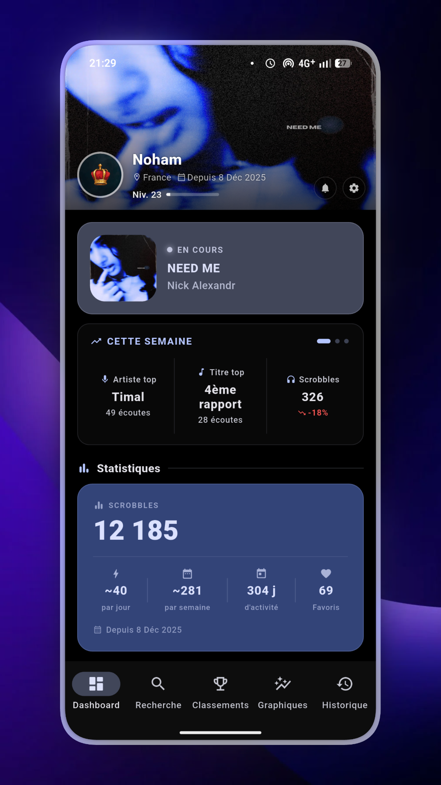
  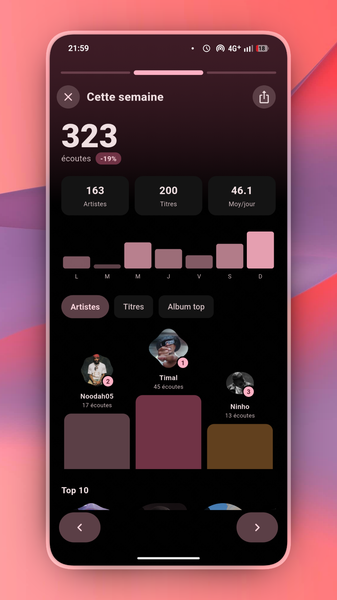
  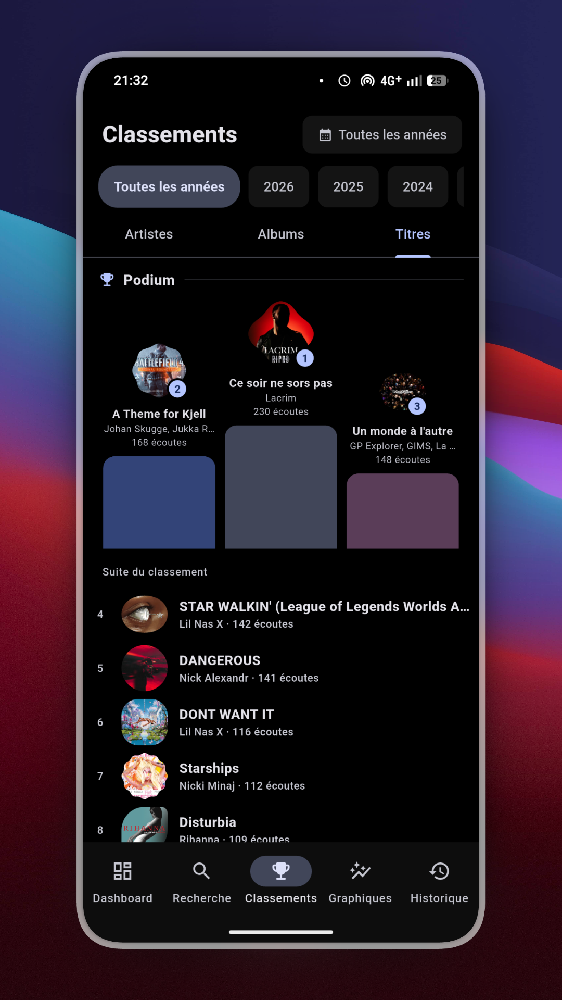
  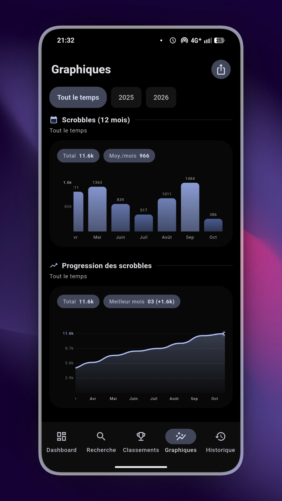
</p>
<p align="center">
  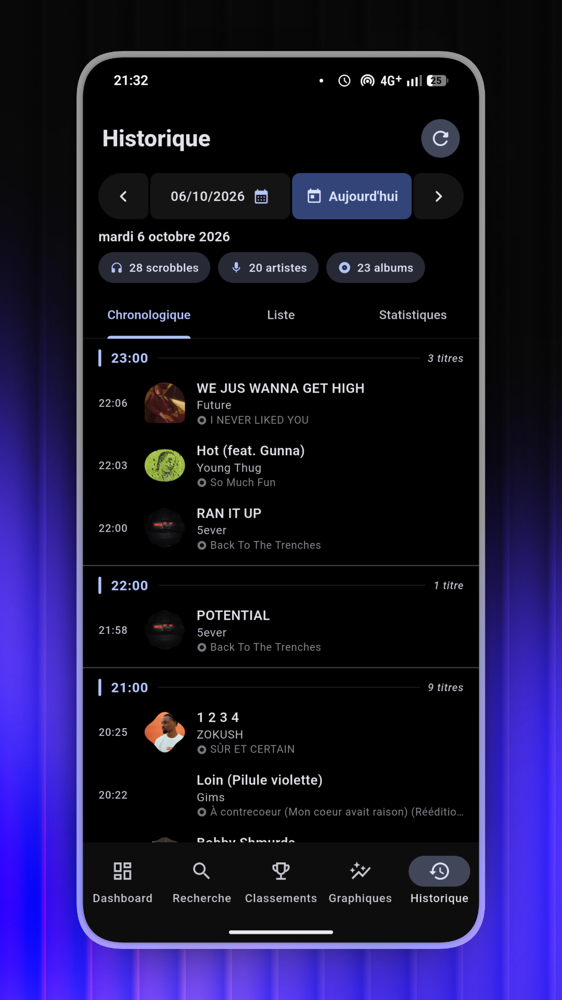
  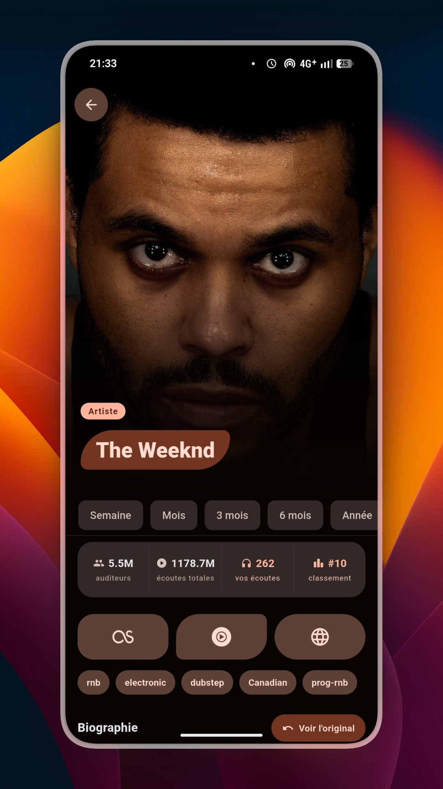
  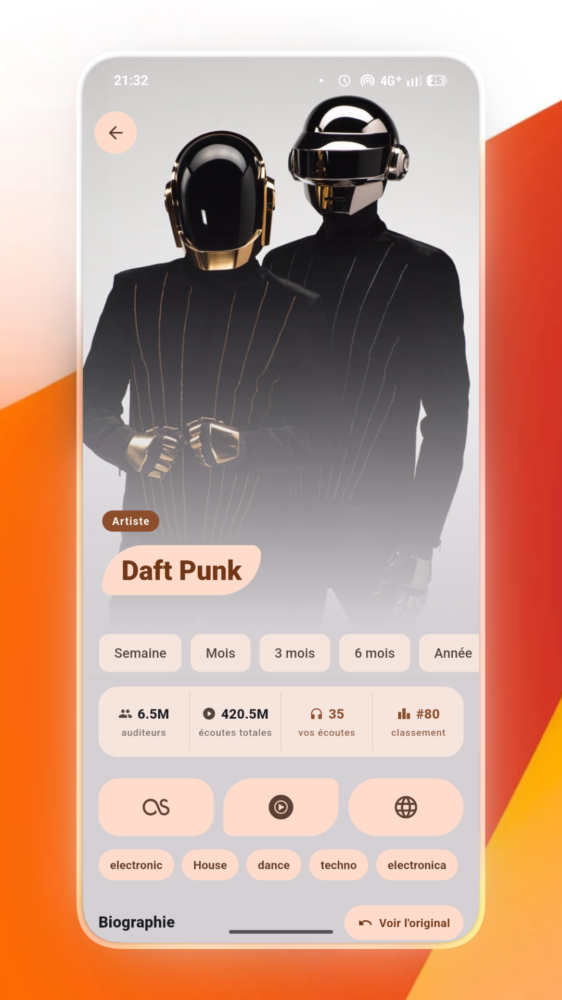
  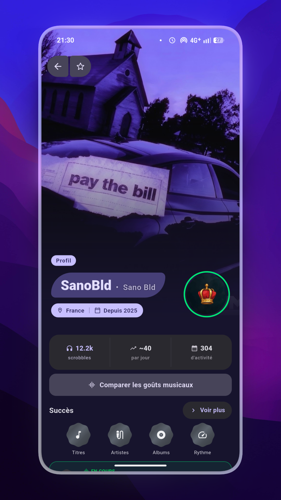
</p>
<p align="center">
  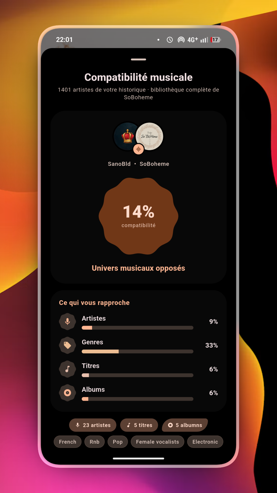
  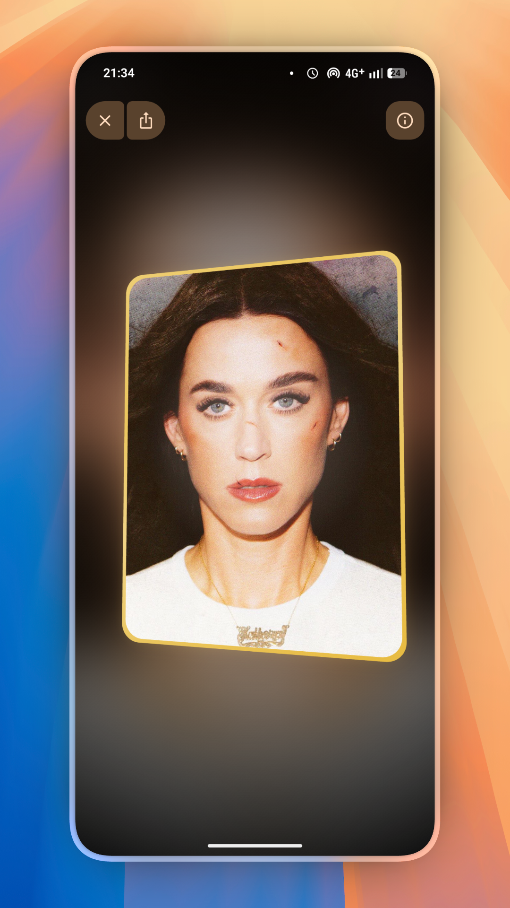
  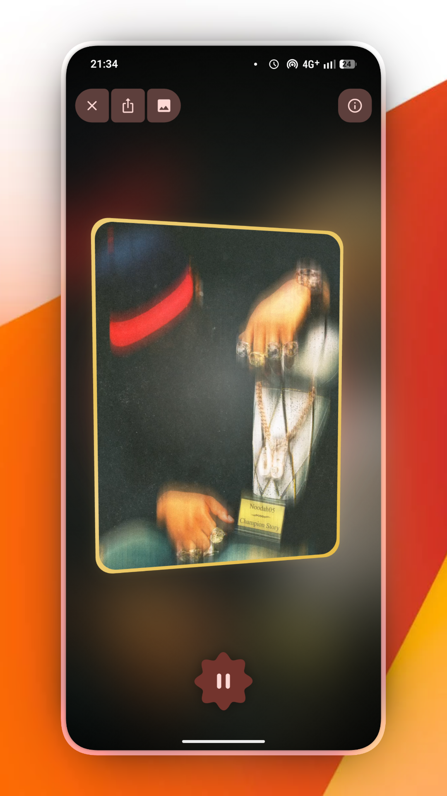
  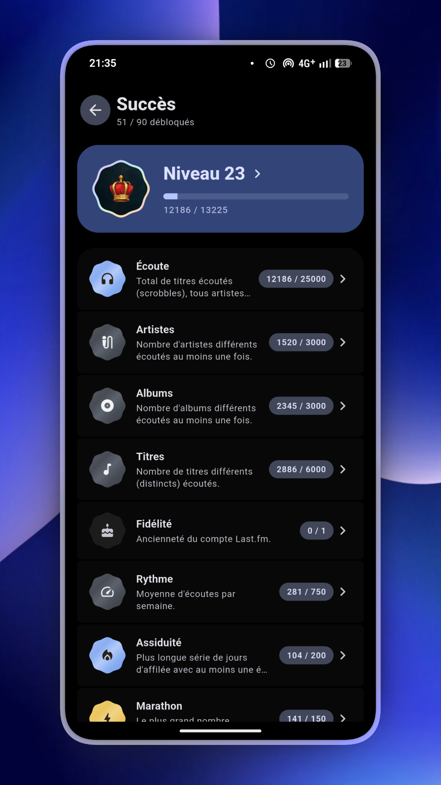
  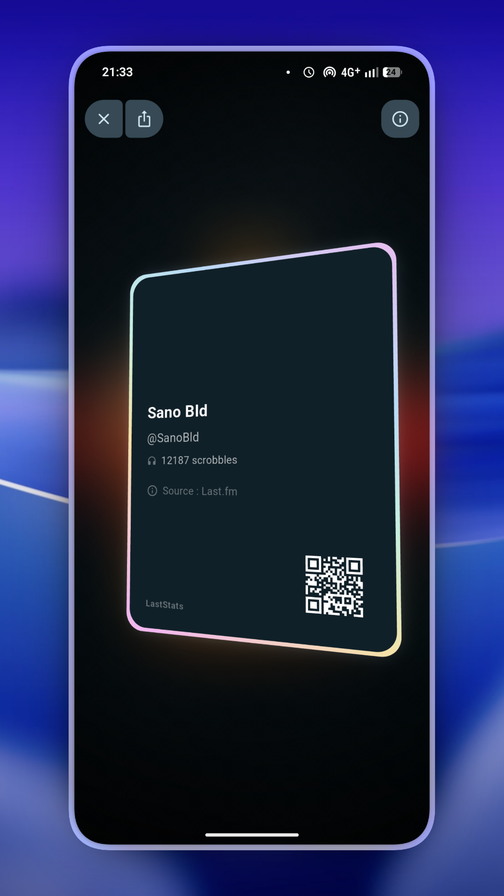
</p>
<p align="center">
  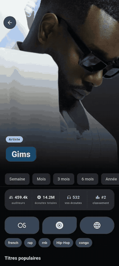
  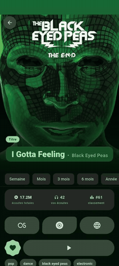
</p>

---

## What you can do with it

**See your listening at a glance.** The dashboard shows what's playing now, your recent tracks, your friends' activity and a calendar of the last 60 days. You can reorder the sections and pick which cards to show.

**Dig into an artist, album or track.** Each page has your own stats, global stats, rank, tags, popular tracks and a biography you can translate. Posters are animated when Apple Music (or a short YouTube loop) has something, and the cover flips in 3D. Lyrics and links to your music platforms are one tap away.

**Look back.** Charts per month and per year, a multi-year heatmap, top artists, albums and tracks with a podium, a day-by-day history with exact scrobble times, and daily, weekly and monthly recaps you can share as images.

**Compare with friends.** Follow your Last.fm friends, see who's listening right now, and get a compatibility score split by artists, genres, tracks and albums. Profile cards can carry a QR code that opens your profile.

**Keep what you love.** Like tracks, artists and albums from the app (it uses your own Last.fm account), and browse them in a Favorites page with folders and filters.

**Unlock achievements.** A level system based on your real listening: totals, variety, loyalty, pace, streaks and more.

**Make it yours.**
- Light, dark or pure black OLED theme, your own accent color or your device's dynamic color, and an optional mode that follows the artwork of the track you're playing
- Adaptive layout: side rail on tablets and PCs, bottom bar on phones
- Library options: remasters, singles and deluxe editions count together, while remixes and live versions stay separate. Collaborations like "Gims & Damso" count for both artists, but bands like "Simon & Garfunkel" stay whole
- Notifications for recaps, milestones and updates, each one can be turned off
- 10 languages (French, English, Spanish, Chinese, Portuguese, German, Italian, Japanese, Russian, Arabic). The translations were made with AI, so a few mistakes are possible

**Under the hood.**
- Real data only: everything comes from the Last.fm API, nothing is simulated
- Use your own API key or the built-in backup one, and see today's requests per service in Settings
- Background sync, an offline cache, and backups where you choose what to export
- If Last.fm has no image, the app looks for one on Wikipedia, iTunes, Deezer, TheAudioDB, MusicBrainz and the Cover Art Archive

---

## Download

Every build is on the [releases page](https://github.com/SanoBld/LastStats/releases). That's the stable option, use it unless you want to test.

Builds from [GitHub Actions](https://github.com/SanoBld/LastStats/actions) follow the latest code and can still have bugs.

Don't want to install anything? Try the [web version (beta)](https://sanobld.github.io/LastStats/app/).

---

## Install

### Android
Download the `.apk` from the [releases page](https://github.com/SanoBld/LastStats/releases):
- `app-arm64-v8a-release.apk` for most phones (2018 and later)
- `app-armeabi-v7a-release.apk` for older 32-bit phones
- `app-x86_64-release.apk` for emulators
- `app-universal-release.apk` if you're not sure

If Android blocks the install, allow "Install unknown apps" for the app you opened the file with, then try again.

### Windows
Download `LastStats-Setup-x64.exe` (most PCs) or `LastStats-Setup-arm64.exe` (Windows on ARM), then run it. Prefer no installer? Use `laststats-windows.zip` or `laststats-windows-arm64.zip`, unzip it and run `LastStats.exe`.

The build isn't code-signed, so SmartScreen may warn you: click "More info" then "Run anyway". Shared files (charts, artwork) are saved in your Downloads folder and shown in Explorer.

### macOS
Download the `.dmg` that matches your Mac: `LastStats-macos-arm64.dmg` (Apple Silicon), `LastStats-macos-x64.dmg` (Intel) or `LastStats-macos.dmg` (universal). `.zip` versions exist too. Drag `LastStats.app` to `Applications`.

The app isn't notarized, so on first launch use right-click → "Open" → "Open".

### Linux
Pick `x64` for most PCs or `arm64` for ARM devices.

```bash
# Any distro, one command
curl -fsSL https://github.com/SanoBld/LastStats/releases/latest/download/install-linux.sh | bash
```

- **Debian / Ubuntu / Mint:** `sudo apt install ./LastStats-linux-<arch>.deb` (remove with `sudo apt remove laststats`)
- **Fedora / openSUSE / RHEL:** `sudo dnf install ./LastStats-linux-<arch>.rpm` (remove with `sudo dnf remove laststats`)
- **No install:** `LastStats-linux-<arch>.AppImage`, then `chmod +x` and run it
- **Manual:** `laststats-linux.zip` (x64) or `laststats-linux-arm64.zip`, extract and run `LastStats`

### iOS
Download `LastStats-ios.ipa`. It isn't signed, so you need to sideload it with AltStore, Sideloadly or TrollStore, or re-sign it with your own Apple account.

### Build from source
You need the [Flutter SDK](https://docs.flutter.dev/get-started/install) (the version in `pubspec.yaml`).

```bash
git clone https://github.com/SanoBld/LastStats.git
cd LastStats
flutter pub get
flutter run            # on a connected device or emulator
flutter build apk      # or: windows / macos / linux
```

---

## Built with

- Flutter, Dart and Material Design 3
- [Last.fm API](https://www.last.fm/api) for your listening data
- Wikipedia, iTunes Search, Deezer, TheAudioDB, MusicBrainz and the Cover Art Archive for missing artwork
- Apple Music and YouTube for animated posters, LRCLIB (and lyrics.ovh as a fallback) for lyrics, ListenBrainz for the worldwide trends in Discover, Google Translate for biographies
- Every open-source package is listed in the app, under Settings → About

---

## ⭐ Star history

<a href="https://www.star-history.com/?repos=SanoBld%2FLastStats&type=date&legend=bottom-right">
  <picture>
    <source media="(prefers-color-scheme: dark)" srcset="https://api.star-history.com/chart?repos=SanoBld/LastStats&type=date&theme=dark&legend=bottom-right&sealed_token=HPdAtBd_SqXDFn9kceQbK4v2Y9TWhOHofoeJdVEg6ySsn4d6BIVPGnnzOdJTzakACyiXmSuvx3pcxDxFhKAQGRJeNwTOvQCCgtJAiBLI0lwOV-hvdNK7mjYRc6PNgeRUWuYssia0e3HcQzx2HzpQuk-OL413b31tu3EgDg2cSVzauc-Lnf76K_FS3vQi" />
    <source media="(prefers-color-scheme: light)" srcset="https://api.star-history.com/chart?repos=SanoBld/LastStats&type=date&legend=bottom-right&sealed_token=HPdAtBd_SqXDFn9kceQbK4v2Y9TWhOHofoeJdVEg6ySsn4d6BIVPGnnzOdJTzakACyiXmSuvx3pcxDxFhKAQGRJeNwTOvQCCgtJAiBLI0lwOV-hvdNK7mjYRc6PNgeRUWuYssia0e3HcQzx2HzpQuk-OL413b31tu3EgDg2cSVzauc-Lnf76K_FS3vQi" />
    
  </picture>
</a>

---

## Help and feedback

Found a bug or have an idea? [Open an issue](https://github.com/SanoBld/LastStats/issues) or come say hi on [Discord](https://discord.gg/JjqmkQgZBs).

---

## Legal

**Independent project.** LastStats is not affiliated with or endorsed by Last.fm, Spotify, YouTube, Apple, Deezer, TheAudioDB, MusicBrainz, Wikipedia or GitHub. Their names and logos belong to their owners. Artwork and metadata belong to their rights holders and come from the sources listed above. Wikipedia text is under CC BY-SA.

**Your data.** Everything stays on your device, and we keep no copy. The app talks directly to the services above, and each one receives at least your IP address and the request (for example an artist name). The camera is only used to scan QR codes. The app isn't meant for children under 15 without a parent's consent.

The full legal notice (publisher, data processed, your rights, third-party services) is here: [sanobld.github.io/LastStats/legal.html](https://sanobld.github.io/LastStats/legal.html). It is also reachable in the app, under Settings → About.

**License.** The code is released under the [MIT License](LICENSE) © 2026 Sano Bld. You can use, modify and redistribute it, just credit us. Open-source packages keep their own licenses, visible in the app.

**AI.** AI helped with part of the development and with the in-app translations.

**Publisher.** Sano Bld (GitHub: [SanoBld](https://github.com/SanoBld)). Contact through Discord or GitHub issues.
